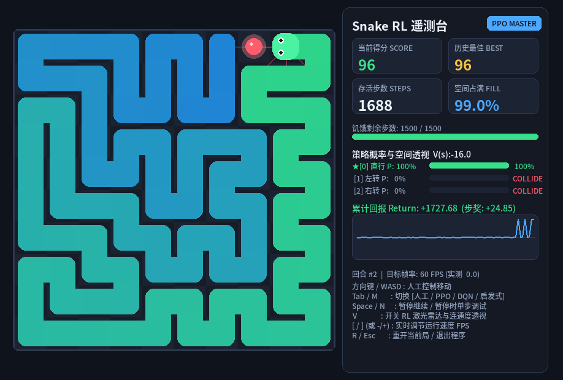
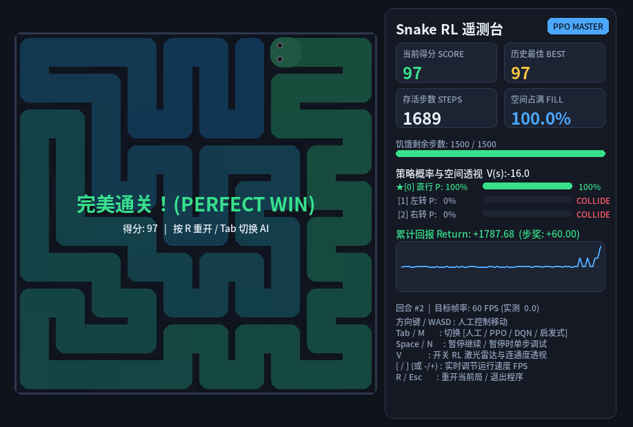
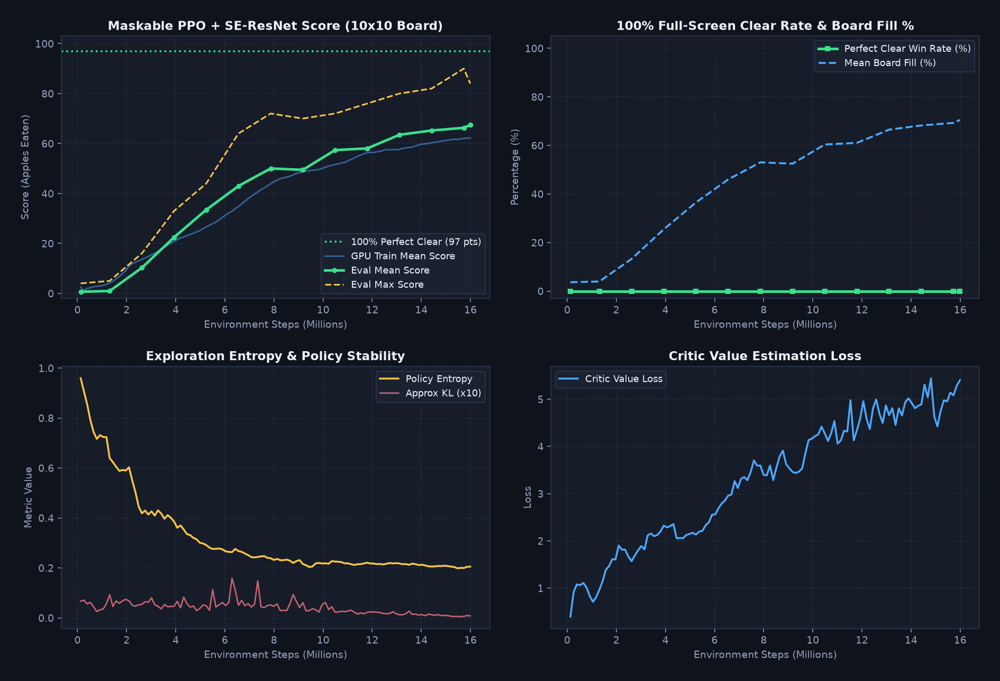
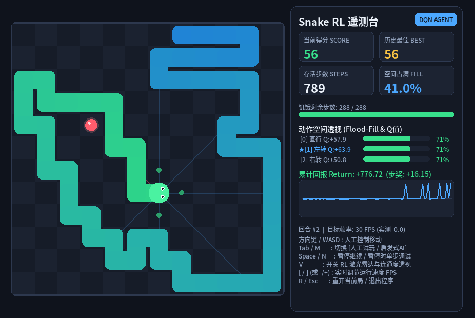

<div align="center">

# 🐍 Snake RL Studio

**面向 100% 满屏完美通关（Perfect Clear）的深度强化学习贪吃蛇实验台**  
*GPU-Native Vectorized Env · Maskable PPO (Ego-SE-ResNet) · 3-Step Dueling Double DQN · Real-Time Pygame Telemetry*

[](https://www.python.org/)
[](https://pytorch.org/)
[](https://gymnasium.farama.org/)
[](LICENSE)

</div>

---

## ✨ 实机演示预览

仓库内置开箱即用的预训练模型权重（`pretrained/`），克隆后无需等待漫长训练即可一键观看 **100% 占满整张屏幕彻底通关（`97 / 97 PERFECT WIN`）**！

| 临门一脚（`96 / 97`，空间占满 `99.0%`） | 完美通关！（`97 / 97`，空间占满 `100.0%`） |
| :---: | :---: |
|  |  |

---

## 🏆 算法演进与盲测基准 (`10×10` 棋盘，满分 `97` 分)

在同一组独立未见测试随机种子下，零探索（Deterministic）权威评测对比：

| 智能体代际 | 核心架构 | 平均得分 (Mean ± Std) | 中位数得分 | 最高得分 | 平均屏幕占满率 | ★ 100% 满分通关率 |
| :--- | :--- | :---: | :---: | :---: | :---: | :---: |
| **Baseline** | 手写启发式 + Flood-Fill 连通域 | `30.45 ± 6.46` | `30.0` | `49 / 97` | `33.5%` | `0.0%` |
| **Gen 1** | 3-Step Dueling Double DQN (24维特征) | `40.30 ± 5.69` | `41.0` | `56 / 97` | `43.3%` | `0.0%` |
| **Gen 2** | 纯前馈 Maskable PPO + Ego-SE-ResNet (0搜索) | `68.42 ± 11.03` | `70.0` | `90 / 97` | `70.5%` | `0.0%` |
| **Gen 3 (旗舰)** | **Ego-SE-ResNet + 禁忌移洞拓扑前瞻** | **`95.82 ± 2.06`** | **`97.0` (满分)** | **`97 / 97`** | **`98.82%`** | **`70.0%` (零撞死)** |

---

## 🧠 核心技术亮点

1. **纯 PyTorch GPU 原生千环境并行引擎 (`TorchSnakeVecEnv`)**：
   - 采用 **TTL（Time-To-Live）寿命矩阵**编码蛇身（蛇尾为 `1` 递增至蛇头 `L`），单行张量减法 `clamp(board - 1, min=0)` 即可在 **1,024 个并行棋盘**上同步完成蛇尾腾空（精确兼容“下一步踏入旧蛇尾合法”物理规则）与碰撞检测，消除 CPU↔GPU 拷贝瓶颈。
2. **第一人称旋转对称表征 (`Ego-centric 8-Channel View`)**：
   - 实时通过 `rot90(k=direction)` 将 8 通道全图特征（蛇头、蛇尾追尾灯塔、蛇身 TTL 解锁梯度、食物、黑白奇偶格、棋盘边界掩码、填充进度、饥饿计时）对齐至“蛇头永远朝上”，赋予卷积网络 **4 倍旋转对称样本效率**。
3. **Maskable PPO + IMPALA-SE-ResNet**：
   - 无池化降采样的残差卷积 + Squeeze-and-Excitation 通道注意力覆盖全局感受野，结合非法动作硬掩码（Invalid Action Masking）与平滑衰减潜势奖励（50% 填充后自动关闭近视距离贪心，解锁后期全局追尾绕圈）。
4. **AlphaZero 风格神经拓扑前瞻与禁忌对角移洞 (`lookahead.py`)**：
   - 融合 `SE-ResNet` 策略先验 $P_\theta(a|s)$、蛇尾连通性护盾、收官禁奇数孤岛不变量与 **Tabu Search 空位对角搬运算法**，当最后 1 颗食物被围死洞时能自动横向绕开直线蛇身墙将空位精准推至食物隔壁双杀通关。
5. **Pygame 实时 RL 遥测可视化台 (`renderer.py`)**：
   - 支持人工键盘试玩与多种 AI 一键无缝切换，实时渲染 **8 向激光测距射线**、三向 Flood-Fill 连通比、**策略动作概率 $P(a|s)$ / Q 值预测**、Critic 局面价值 $V(s)$ 与最近 80 步即时奖励折线图。

| Maskable PPO (Ego-SE-ResNet) 训练曲线 | 3-Step Dueling Double DQN (12×12) 实机展示 |
| :---: | :---: |
|  |  |

---

## 🚀 快速开始

### 1. 克隆仓库并安装环境

推荐使用 [`uv`](https://docs.astral.sh/uv/)（或标准 `pip`）：

```bash
git clone https://github.com/Arbaonwsas/snake-rl.git
cd snake-rl

# 使用 uv 一键创建虚拟环境并安装依赖
uv sync

# （可选）若不使用 uv，也可直接使用标准 venv + pip：
# python3 -m venv .venv && .venv/bin/pip install -e ".[dev]"
```

### 2. 一键启动可视化窗口（开箱即用预训练权重）

```bash
# 【推荐】直接观看宗师级 PPO MASTER 冲击 100% 满屏通关！（按 ] 键可加速至 90/240 FPS）
uv run python scripts/play.py --mode ppo

# 观看 24 维特征 Dueling Double DQN 智能体实战（12x12 棋盘，展示三向 Q 值）
uv run python scripts/play.py --mode dqn --grid-size 12

# 启动人工键盘试玩模式（随时按 Tab 键在 [人工 -> PPO -> DQN -> 启发式 AI] 之间循环切换！）
uv run python scripts/play.py
```

#### 窗口快捷键说明

| 按键 | 功能说明 |
| :--- | :--- |
| `方向键` / `WASD` | 人工模式下控制贪吃蛇转向（内置双帧转向缓冲与防 180° 自杀保护） |
| `Tab` / `M` | 循环切换控制者：**[人工试玩]** → **[PPO 满盘模型]** → **[DQN 模型]** → **[启发式 AI]** |
| `Space` / `N` | 暂停或继续 / 暂停状态下按 `N` **逐帧单步调试** |
| `V` | 开启 / 关闭棋盘上的 **8 向激光雷达与三向安全度透视层** |
| `[` / `]`（或 `-` / `+`） | 实时调节运行帧率（`5` / `10` / `15` / `25` / `45` / `90` / `240 FPS`） |
| `R` / `Esc` | 立即重开当前回合 / 退出窗口 |

---

## 🔥 从头复现强化学习训练

```bash
# 1. 训练 Maskable PPO + Ego-SE-ResNet 满盘模型（GPU 1,024 环境并行，1,600 万步）
uv run python scripts/train_ppo.py --total-steps 16000000 --grid-size 10 --num-envs 1024

# 2. 训练 3-Step Dueling Double DQN 模型（16 环境并行，40 万步，约 4.5 分钟）
uv run python scripts/train_dqn.py --total-steps 400000 --num-envs 16 --grid-size 12

# 3. 启动 TensorBoard 实时查看收敛指标
uv run tensorboard --logdir runs

# 4. 运行全量单元测试与环境吞吐量基准测试
uv run pytest -v
uv run python scripts/benchmark_env.py
```

---

## 📂 项目目录结构

```text
snake-rl/
├── assets/                  # 实机演示截图与训练收敛曲线图
├── pretrained/              # 随仓库发布的轻量化预训练模型权重 (best_ppo.pt / best_dqn.pt)
├── src/snake_rl/
│   ├── config.py            # 游戏规则、奖励塑造与视觉配色参数配置
│   ├── core.py              # 高性能无头贪吃蛇物理引擎、8向射线与连通分量复用算法
│   ├── env.py               # 标准 Gymnasium 环境 (SnakeRL-v0)，支持 features 与 grid 双模式
│   ├── renderer.py          # Pygame 现代化游戏渲染器与实时 RL 遥测侧边栏
│   ├── cli.py               # 交互式观战与离屏截图导出入口
│   ├── dqn/                 # 3-Step Dueling Double DQN 网络、环形经验池与并行训练器
│   └── ppo/                 # GPU 原生并行环境、Ego-SE-ResNet、Maskable PPO 与拓扑移洞前瞻
├── scripts/
│   ├── play.py              # 启动可视化窗口
│   ├── train_ppo.py         # 训练满盘通关 PPO 模型与百局盲测
│   ├── train_dqn.py         # 训练 Dueling Double DQN 模型
│   └── benchmark_env.py     # Gymnasium API 合规检查与采样吞吐率评测
└── tests/                   # Pytest 自动化测试套件（物理规则、GPU/CPU 对齐、DQN、PPO）
```

## 📄 开源协议

本项目基于 [MIT License](LICENSE) 开源。欢迎 Star ⭐、Fork 与交流改进！
